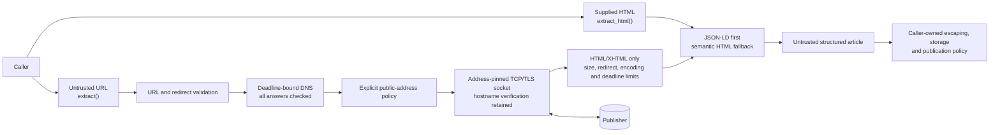

# Trust boundary

The extractor has two entry paths with one shared parsing surface. Supplied HTML skips the network entirely; URL extraction crosses an explicit outbound-request boundary before the same parser sees any bytes.

## What the library owns

- URL syntax, credential, scheme, port, redirect, downgrade, DNS-address, content-type, encoding, size and absolute-deadline checks.
- Connecting to the vetted address while retaining the original hostname for TLS verification and the `Host` header.
- Parsing without executing JavaScript and excluding common page chrome from the semantic fallback.
- Returning `None` on a fetch or minimum-content failure while emitting redacted diagnostics.

## What remains outside the boundary

- Permission to crawl or republish a publisher's content, robots guidance, copyright, privacy and rate limits.
- Correct escaping and authorization at the caller's eventual terminal, HTML, database or API destination.
- Publisher availability, bot defenses, paywalls, markup drift and JavaScript-only content.
- Trusted internal-network access, which is disabled by default and requires an explicit opt-in.

The [versioned deterministic benchmark](../benchmarks/results/corpus-v1-v0.2.0.md) exercises parser decisions after the network boundary. Network-policy behavior is covered separately by the unit suite so parser quality, transport safety and publisher availability are not collapsed into one misleading score.
